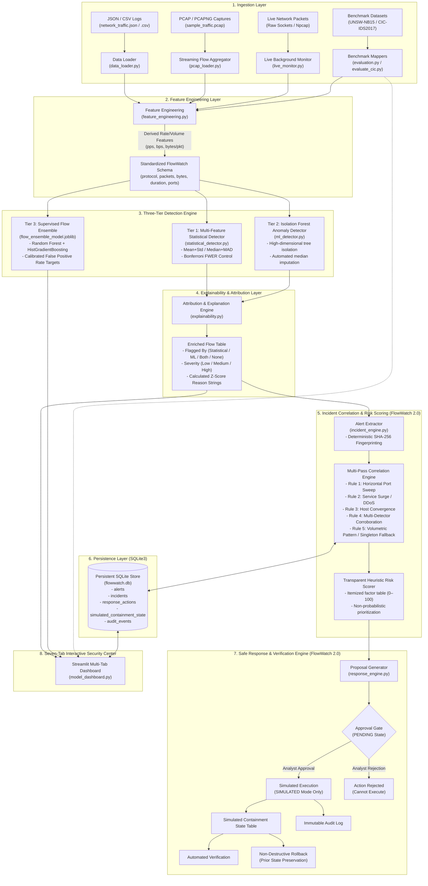
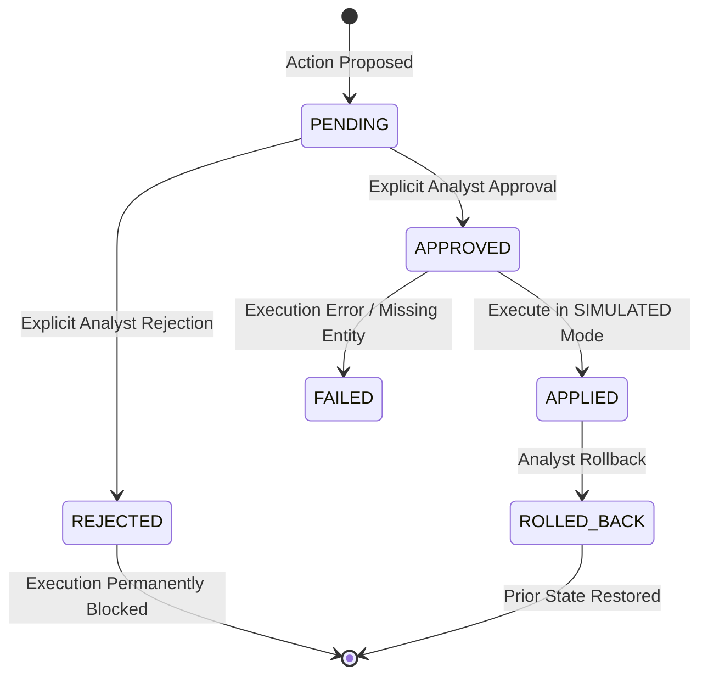

# FlowWatch 2.0 — System Architecture & Technical Specifications

FlowWatch 2.0 is a modular, defense-in-depth network threat detection, investigation, and simulated response platform. It integrates statistical process control, unsupervised outlier isolation, supervised ensemble classification, rule-based incident correlation, transparent heuristic risk scoring, and approval-gated simulated response into an interactive seven-tab interface.

---

## 1. High-Level System Architecture



---

## 2. Ingestion & Preprocessing Subsystems

### 2.1 File Ingestion (`data_loader.py`)
- Ingests structured JSON and CSV network logs.
- Enforces strict validation: requires `protocol` and `packets`, drops records with missing mandatory fields, and rejects negative packet counts with descriptive errors.
- Trims whitespace and normalizes column headers to lowercase.

### 2.2 Streaming PCAP Flow Aggregator (`pcap_loader.py`)
- Streams raw packet captures via Scapy without accumulating entire packet lists in RAM.
- Aggregates individual packets into **bidirectional 5-tuple flows**:
  $$\text{Flow Key} = (\text{Src IP}, \text{Dst IP}, \text{Src Port}, \text{Dst Port}, \text{Protocol})$$
- Computes flow start timestamp, end timestamp, flow duration ($t_{\text{last}} - t_{\text{first}}$), packet volume, and total bytes.
- **Privacy & Safety Guarantees**: Payload contents and raw packet buffers are discarded immediately after header parsing; only metadata is retained.
- Single-packet flows default to a duration of `0.0` seconds.
- Configurable packet capping (`max_packets`, default 200,000) prevents denial-of-service on large packet captures.

### 2.3 Live Traffic Monitor & Windows Adapter Auto-Discovery (`live_monitor.py`)
- Background packet sniffing using Scapy's `AsyncSniffer` operating in a non-blocking daemon thread.
- **Windows Adapter Auto-Discovery**: Probes `scapy.arch.windows.get_windows_if_list()` to enumerate friendly names (e.g., "Wi-Fi", "Ethernet") and NPF device GUIDs (`\Device\NPF_{...}`). Degrades gracefully to `get_if_list()` or `[]` if Npcap is unavailable.
- **Rolling Memory Window**: Discards flows older than the specified time horizon (e.g., 120 seconds) and caps tracked flows at `max_flows` (default 20,000) using FIFO LRU pruning.
- **Temporal Metrics**: Aggregates packets per second and bytes per second across time slices for temporal trend charts.
- **Session Alert History & Deduplication**: Captures anomalous flows into a persistent session log (`alert_log`) while deduplicating repeated alerts for the same active flow state across dashboard auto-refresh reruns.

### 2.4 Feature Engineering (`feature_engineering.py`)
Computes derived rate and volume characteristics only when requisite columns exist:
- $\text{packets\_per\_sec} = \frac{\text{packets}}{\text{duration}}$
- $\text{bytes\_per\_sec} = \frac{\text{bytes}}{\text{duration}}$
- $\text{bytes\_per\_packet} = \frac{\text{bytes}}{\text{packets}}$

**Zero-Division & Edge-Case Protection**:
- If $\text{duration} \le 0$, missing, or non-numeric, rate features evaluate to `NaN` (never divided by zero; missing duration is never assumed to be zero traffic).
- If $\text{packets} \le 0$ or missing, $\text{bytes\_per\_packet}$ evaluates to `NaN`.

---

## 3. Three-Tier Detection Engine Specifications

```
+--------------------------------------------------------------------------------------------------+
|                                    FlowWatch Detection Engine                                    |
+---------------------------------+--------------------------------+-------------------------------+
| Tier 1: Statistical Detector    | Tier 2: Isolation Forest       | Tier 3: Supervised Ensemble   |
| (statistical_detector.py)       | (ml_detector.py)               | (flow_ensemble_model.joblib)  |
+---------------------------------+--------------------------------+-------------------------------+
| * Unsupervised univariate test  | * Unsupervised multivariate    | * Supervised binary classifier|
| * Transparent baseline metrics  | * Subsampling path length      | * RF (200 trees) + HGB        |
| * Bonferroni FWER control       | * Detects complex correlations | * Calibrated FPR targets      |
| * Mean+Std or Median+MAD        | * Column median imputation     | * High precision on known DoS |
+---------------------------------+--------------------------------+-------------------------------+
```

### 3.1 Tier 1: Multi-Feature Statistical Anomaly Detector (`statistical_detector.py`)
Evaluates continuous flow variables: `packets`, `bytes`, `duration`, `packets_per_sec`, `bytes_per_sec`, and `bytes_per_packet`. Metadata fields such as port numbers and IP addresses are excluded from continuous statistical thresholds.

#### Baseline Modes:
1. **Mean + Standard Deviation** (`mean_std`):
   $$\mu = \frac{1}{N}\sum_{i=1}^N x_i, \quad \sigma = \sqrt{\frac{1}{N-1}\sum_{i=1}^N (x_i - \mu)^2}$$
   $$\text{Threshold}_j = \mu_j + (k_{\text{adj}} \cdot \sigma_j)$$
2. **Median + Median Absolute Deviation** (`median_mad`, robust against existing outliers):
   $$\tilde{x} = \text{median}(x), \quad \text{MAD} = \text{median}(|x_i - \tilde{x}|)$$
   $$\hat{\sigma} = 1.4826 \cdot \text{MAD}$$
   $$\text{Threshold}_j = \tilde{x}_j + (k_{\text{adj}} \cdot \hat{\sigma}_j)$$

#### Bonferroni Adjustment for Multiple Testing:
When evaluating $m$ continuous features simultaneously on each flow, unadjusted testing inflates the family-wise error rate ($\alpha_{\text{family}} \approx 1 - (1 - \alpha)^m$). FlowWatch applies Bonferroni correction under Gaussian survival assumptions:
$$\alpha = 1 - \Phi(k_{\text{base}})$$
$$\alpha_{\text{adj}} = \frac{\alpha}{m}$$
$$k_{\text{adj}} = \Phi^{-1}(1 - \alpha_{\text{adj}})$$
Where $\Phi$ is the standard normal cumulative distribution function. For a base multiplier $k=2.0$ ($\alpha \approx 0.0228$) across $m=6$ features:
$$\alpha_{\text{adj}} = \frac{0.02275}{6} \approx 0.00379 \implies k_{\text{adj}} \approx 2.67$$
If a feature has zero variance (constant column or zero MAD), the detector sets $\text{Threshold}_j = \infty$, preventing division-by-zero and eliminating false alarms.

### 3.2 Tier 2: Unsupervised Isolation Forest (`ml_detector.py`)
- Isolates multi-dimensional outliers by recursively partitioning randomized orthogonal hyperplanes.
- Outliers require fewer partitions to isolate than clustered inliers, yielding shorter average path lengths $h(x)$ on an ensemble of 100 isolation trees:
  $$s(x, n) = 2^{-\frac{E(h(x))}{c(n)}}$$
  Where $c(n) = 2\ln(n - 1) + 0.5772156649 - \frac{2(n - 1)}{n}$ is the average path length of unsuccessful searches in binary search trees.
- **Robust Imputation**: Pre-cleans features with `.replace([np.inf, -np.inf], np.nan)`, fills missing rate features with the column median, and falls back to `0.0`. Preserves exact row counts without dropping records.

### 3.3 Tier 3: Supervised Flow Ensemble (`flow_ensemble_model.joblib`)
- Pre-trained ensemble combining **Random Forest** (200 trees, balanced subsampling) and **HistGradientBoosting** (histogram-binned gradients).
- **Standardized Live/PCAP Feature Vector** (10 features):
  `['packets', 'bytes', 'duration', 'packets_per_sec', 'bytes_per_sec', 'bytes_per_packet', 'source_port', 'dest_port', 'proto_tcp', 'proto_udp']`
- **Ensemble Decision Score**:
  $$S(x) = \frac{P_{\text{RF}}(y=1 \mid x) + P_{\text{HGB}}(y=1 \mid x)}{2}$$
- **Calibrated False-Positive Rate Operating Points**:
  - `0.1% FPR target`: Threshold $\approx 0.9808$ (extreme precision; minimizes false alerts)
  - `0.5% FPR target`: Threshold $\approx 0.9259$
  - `1.0% FPR target`: Threshold $\approx 0.8860$
  - `5.0% FPR target`: Threshold $\approx 0.7187$
  - `Threshold 0.5`: Standard majority probability cutoff

---

## 4. Explainability & Attribution Layer (`explainability.py`)

Every flagged record is enriched with interpretable diagnostic metadata:
1. **Attribution (`Flagged By`)**:
   - `Statistical`: Flagged only by continuous distribution thresholds.
   - `ML`: Flagged only by Isolation Forest high-dimensional tree isolation.
   - `Both`: Flagged independently by both statistical and ML algorithms (highest confidence).
   - `None`: Classified as normal traffic by all detectors.
2. **Deviation Formatting**:
   Calculates the normalized distance from the distribution center:
   $$z = \frac{x_i - \text{center}}{\text{scale}}$$
   Generates human-readable explanations (e.g., *"Packet count 4.1 std above baseline; bytes 3.2 std above baseline"*). If Isolation Forest flags a multivariate outlier whose individual continuous features do not exceed statistical thresholds, the reason transparently notes: *"Isolation Forest flagged on multi-feature combination"*.
3. **Severity Grading**:
   - `High`: Flagged by Both methods, or $z \ge 3.0$ on any continuous feature.
   - `Medium`: Flagged by Statistical detector with $z \ge 2.0$.
   - `Low`: Flagged by ML alone or minor deviations.

---

## 5. FlowWatch 2.0: Incident Management Subsystem (`incident_engine.py`)

### 5.1 Alert Extraction & Deduplication Fingerprinting
- Inspects flagged records after detection.
- Computes a deterministic SHA-256 fingerprint from core flow attributes:
  $$\text{Fingerprint} = \text{SHA256}(\text{source\_type} \parallel \text{proto} \parallel \text{packets} \parallel \text{bytes} \parallel \text{src\_ip} \parallel \text{dst\_ip} \parallel \text{src\_port} \parallel \text{dst\_port} \parallel \text{flagged\_by} \parallel \text{reasons})$$
- Prevents alert duplication on repeated dataset loads or dashboard reruns.

### 5.2 Deterministic Multi-Pass Correlation Rules
To prevent SOC alert fatigue, individual alerts are correlated into actionable security incidents via five deterministic passes:

```
+---------------------------------------------------------------------------------------------------+
|                                  Multi-Pass Correlation Pipeline                                  |
+--------+--------------------------+-------------------------------------+-------------------------+
| Pass   | Rule Name                | Trigger Condition                   | Primary Entity Formed   |
+--------+--------------------------+-------------------------------------+-------------------------+
| Pass 1 | RULE_PORT_SWEEP          | Single source probes >= 3 dports    | Source IP (Host)        |
| Pass 2 | RULE_SERVICE_SURGE       | >= 3 distinct sources target dport  | Destination Port/Proto  |
| Pass 3 | RULE_SRC_HOST            | >= 2 distinct alerts from same src  | Source IP (Host)        |
| Pass 4 | RULE_MULTI_DETECTOR      | Corroborated by Both or Ensemble>=.8| Source IP or Protocol   |
| Pass 5 | RULE_VOLUMETRIC_BURST    | >= 2 alerts share (proto, reasons)  | Protocol                |
| Fallback| RULE_SINGLETON          | Standalone un-correlated alert      | Flow description        |
+--------+--------------------------+-------------------------------------+-------------------------+
```

### 5.3 Transparent Heuristic Risk Scoring
FlowWatch 2.0 intentionally avoids uncalibrated "black-box" risk percentages. It computes an itemized, deterministic heuristic index (0–100):

| Risk Factor | Points Added | Rationale |
|---|---|---|
| **Base Severity** | Critical: 40, High: 30, Medium: 20, Low: 10 | Primary severity grade of underlying alerts |
| **Multi-Detector Corroboration** | +25 | Flagged independently by Statistical + ML tiers |
| **Supervised Ensemble Corroboration** | +20 | Supervised probability $\ge 0.85$ |
| **High Alert Volume** | +15 ($\ge 5$ alerts) or +10 ($\ge 2$ alerts) | Repeated persistent anomalous flows |
| **Horizontal Port Diversity** | +15 ($\ge 3$ ports targeted) | Reconnaissance sweep behavior |
| **High Byte Volume** | +10 ($\ge 10$ MB aggregated) | Potential data exfiltration or volumetric flooding |

Score is bounded: $\text{Risk Score} = \min(100, \sum \text{Factors})$.

---

## 6. Persistence Layer (`incident_store.py`)

FlowWatch uses Python's standard-library `sqlite3` configured with write-ahead logging (WAL mode) and strict foreign keys:

### 6.1 Schema Architecture
1. **`alerts`**: Normalized security alerts with SHA-256 fingerprint, source type, protocol, packet/byte counts, IPs, ports, detector attributions, reasons, and raw metadata.
2. **`incidents`**: Correlated security incidents with status (`New`, `Investigating`, `Contained`, `Resolved`, `Closed`), severity, risk score, itemized risk factors, primary entity, and summary.
3. **`incident_alerts`**: Junction table mapping many-to-many relationships between incidents and alerts.
4. **`response_actions`**: Action lifecycle records with status (`Pending`, `Approved`, `Rejected`, `Applied`, `Failed`, `Rolled Back`), execution mode (`SIMULATED`), approver, timestamps, and parameters.
5. **`simulated_containment_state`**: State table tracking active simulated containment (`BLOCKED_SOURCE`, `BLOCKED_PORT`, `WATCHED_SOURCE`), including the `was_prior_state` flag.
6. **`audit_events`**: Immutable audit log of all security events, proposals, approvals, rejections, executions, verifications, and rollbacks.

### 6.2 Deduplication & Rerun Protection
- During dashboard execution, `IncidentEngine.process_and_persist(..., skip_already_associated=True)` queries `IncidentStore.get_associated_alert_ids()`. Alerts already linked to an existing incident are never re-ingested or re-grouped into duplicate incidents on page refreshes.

---

## 7. Simulated Response & Rollback Engine (`response_engine.py`)

### 7.1 Safe Simulated Playbooks
FlowWatch 2.0 provides four safe incident response actions:
- `SIMULATE_BLOCK_SOURCE`: Records source IP in simulated containment table. Transitions incident to `CONTAINED`.
- `SIMULATE_BLOCK_DESTINATION_PORT`: Records targeted destination port in simulated containment table. Transitions incident to `CONTAINED`.
- `WATCH_SOURCE`: Adds suspicious host to simulated surveillance watchlist. Does not transition to `CONTAINED`.
- `MARK_FOR_INVESTIGATION`: Sets incident status to `INVESTIGATING` for deeper analysis. Does not claim containment.

### 7.2 Approval Gating State Machine



- **Approval Gate**: Calling `execute_action()` on a `PENDING` action raises `PermissionError`.
- **Rejection Gating**: Calling `execute_action()` on a `REJECTED` action raises `PermissionError`.
- **Re-Execution Protection**: Calling `execute_action()` on an already `APPLIED` action raises `ValueError`.

### 7.3 Verification & Non-Destructive Rollback Semantics
- **Verification**: Querying `verify_action()` checks that the targeted entity actively exists in the `simulated_containment_state` table with status `ACTIVE`.
- **Rollback Isolation (`was_prior_state`)**:
  When an action adds an entity to simulated containment, the engine inspects whether that entity was already active due to an earlier action. On rollback, only the entries created by this specific action are marked `ROLLED_BACK`. If another active action also blocked that entity, the entity remains active, preventing unintended security unblocking.
- **Incident Lifecycle Reversion**:
  On action rollback, the incident status transitions from `CONTAINED` back to `INVESTIGATING` (or `RESOLVED`), provided no other active containment action exists for that incident.

---

## 8. Presentation & Dashboard Integration (`model_dashboard.py`)

FlowWatch presents all capabilities across seven tabs:
1. **Overview**: Metric cards (Total flows, Anomaly count, Detection rate, Incident count), protocol breakdown chart, and traffic distribution.
2. **Traffic Analytics**: Volume scatter plots (Packets vs Bytes), rate distributions (`packets_per_sec`, `bytes_per_sec`), and live temporal trend charts.
3. **Anomaly Investigation**: Filterable table of flagged flows with severity tags, calculated z-score reason strings, and live session alert history.
4. **Model Comparison**: Detection matrix (Statistical vs ML vs Supervised Ensemble), agreement breakdown, and interactive ensemble operating point selector.
5. **Evaluation**: Benchmark evaluation switcher (UNSW-NB15 vs CIC-IDS2017) with Precision-Recall scatter plots, ROC curves, feature importance rankings, and per-category attack recall.
6. **Reports**: Printable threat report with executive summaries and CSV export buttons.
7. **Incident Response & Triage**: Complete SOC triage interface:
   - Incident queue with status, severity, risk score, and primary entity.
   - Expandable incident inspector showing correlated alert breakdown and itemized risk factors.
   - Proposal creation and approval gating workflow.
   - Execution controls in strictly `SIMULATED` mode.
   - Active simulated containment state tables with live verification indicators.
   - Rollback action controls with prior-state protection.
   - Immutable audit trail log table.

---

## 9. Safety Guarantees & Non-Goals

1. **Simulation Safety**: FlowWatch **never** invokes administrative OS commands (`iptables`, `netsh`, `route`, `pfctl`) and **never** modifies real network state.
2. **Privacy Preservation**: PCAP loading and live packet sniffing discard packet payload data immediately; only header metadata (5-tuple, volume, duration) is parsed.
3. **Resource Bounding**: Live monitoring uses bounded FIFO rolling memory windows; PCAP aggregation caps processed packets; SQLite operates in bounded connection pools with transactional ACID rollback.
